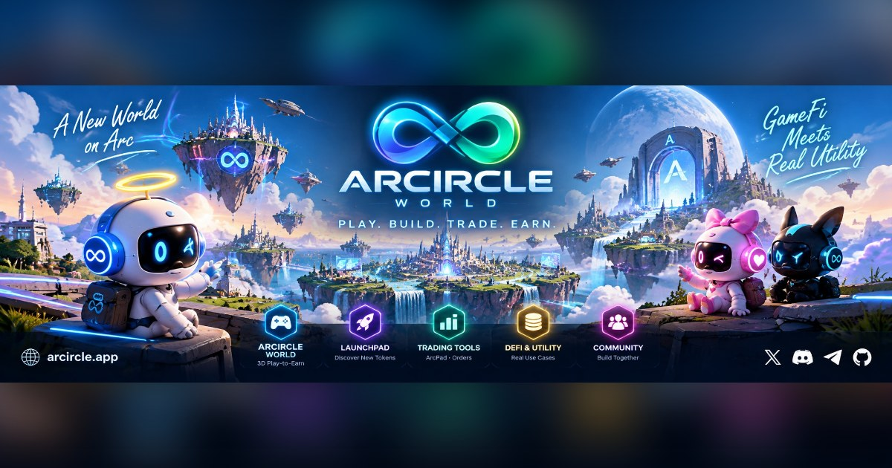

<p align="center">
  
</p>

<h1 align="center">♾ ARCIRCLE</h1>

<p align="center">
  A community launchpad and on-chain playground on <a href="https://www.arc.io">Circle's Arc</a>, with a second home on <a href="https://docs.robinhood.com/chain">Robinhood Chain</a>.<br>
  Launch a coin for 1 USDC, fund one together, trade, predict, stake — and walk around it all in a 3D world.
</p>

<p align="center">
  <a href="https://www.arcircle.app">arcircle.app</a> ·
  <a href="https://www.arcircle.app/arc">ArcPad</a> ·
  <a href="https://www.arcircle.app/circle">CirclePad</a> ·
  <a href="https://www.arcircle.app/play">Game World</a> ·
  <a href="https://www.arcircle.app/arcia">ARCIA</a> ·
  <a href="https://x.com/ARCIRCLEonArc">X</a> ·
  <a href="https://t.me/ARCIRCLEonarc">Telegram</a>
</p>

<p align="center">
  
  
  
  
</p>

---

## What ARCIRCLE is

ARCIRCLE PAD is a launchpad built on Circle's Arc chain, where gas is paid in USDC. It started with one idea — anyone should be able to launch a coin with real liquidity from the first block — and grew into a small ecosystem around **$ARCIRCLE**: community-funded launches, a swap, prediction rounds, staking that pays you in every new coin, an AI mascot, and a 3D game world you can walk through.

Everything that moves money is a contract you sign yourself. The site never holds your keys and never sends a transaction for you.

## Official coins

Only these two coins are official. Anything else using the ARCIRCLE or ARCIA name is not ours.

| Coin | Chain | Contract |
|---|---|---|
| ♾ `$ARCIRCLE` | Arc | `0xe5718F298ac3b65FAf7c711b56cBD72b3bb15fF7` |
| 💙💚 `$ARCIA` | Robinhood Chain | `0xF0C0fC281314a48aE4E52a9db08731cb6A38CA25` |

`$ARCIRCLE` on Robinhood Chain (`0x6F9EBd0DFc6De9ed47EEc18EfeB69A9b97C71ee4`) is the **same** coin bridged through ARCIRCLE OMNI (LayerZero): it is minted only when `$ARCIRCLE` is locked on Arc, 1 for 1, so both chains share one supply of 1,000,000,000.

The old `$ARCIA` on Arc and the ♾ Infinite test coin were retired on 5 October 2026 and are not official.

## Products

### Launch
- **ArcPad** (`/arc#launch`) — instant, permissionless launches. A real Uniswap v4 pool exists from the first block, with single-sided liquidity locked for good. 1 USDC to launch on Arc (USDC pair), or about $1 in ETH on Robinhood Chain (ETH pair). Fixed supply of 1,000,000,000; 8% goes to the platform treasury at creation. A 1% base fee on every trade, most of it to the creator; creators can add up to 2% more, all theirs.
- **CirclePad** (`/circle`) — community-funded launches, one project at a time. A 72-hour USDC raise into an on-chain escrow, burn-to-vote on the name, ticker, logo and roadmap (every vote burns 1,000 `$ARCIRCLE`), then one transaction splits the escrow 80 / 15 / 5 and the coin launches with an airdrop to contributors. Every round's report is public at `/circle/round/<n>`.
- **Launch Drop** — stake `$ARCIRCLE` and receive a piece of every new ArcPad coin: half of the treasury's 8% (4% of each new coin's supply) goes to veARCIRCLE holders, paid by a contract.

### Trade and play
- **ARCIRCLE Swap** (`/arc#swap`) — buy and sell any Arc token with a Uniswap v4 pool in one transaction, routed through USDC and `$ARCIRCLE`. 0.1% fee; when it's taken in `$ARCIRCLE`, half is burned.
- **ARCIRCLE Orders** (`/arc#orders`) — limit, stop and market orders on Arc, Robinhood Chain and Solana.
- **ARCIRCLE Predict** (`/arc#predict`) — scheduled UP / DOWN rounds on Arc tokens in USDC, plus multiplier rounds with four price bands, and rounds on Robinhood Chain coins in ETH.
- **Paper Trading** (`/arc#paper`) — a weekly event with $10,000 of play money on live BTC, ETH and SOL prices. Sign in with a message: no gas, no real money.
- **ARCIRCLE Scanner** (`/arc#scanner`) — a quick safety read of a token before you buy.

### Hold
- **ARCIRCLE Staking / veARCIRCLE** (`/arc#staking`) — lock `$ARCIRCLE` for 1 week to 1 year for veARCIRCLE, which earns the Launch Drop, raffle weight and voting tiers (Bronze, Silver, Gold, Diamond).
- **veARCIA** (`/arc#vearcia`, Robinhood Chain) — stake `$ARCIA` for 1 to 20 days for a share of a streaming `$ARCIA` reward pool, boosted for `$ARCIRCLE` holders.
- **ARCIRCLE NFT Vault** (`/arc#nft`) — creator fees from team launches buy NFTs that are raffled to `$ARCIRCLE` holders. The vault has no withdraw.

### ARCIA
ARCIA is ARCIRCLE's virtual idol and AI mascot ([@ARCIAonArc](https://x.com/ARCIAonArc)). She answers questions about the platform in the site chat (`/arcia`), in English, Korean and Chinese, and only from what the platform actually publishes. ARCIA DESK (`/arc#desk`, beta) is her trading desk with on-chain limits the owner sets.

### ARCIRCLE World
The home page opens on a 3D gate with two ways in: **Platform World** (the site) and **Game World** (`/play`), an open planet split into districts where you walk between the halls, fight scammers in hunting grounds, build your own island, join a weekly raid, collect gear at the Forge and team up in crews. The town shows the platform live: $ARCIRCLE's price, burns and new ArcPad launches turn on an LED band round the plaza fountain, with fireworks for every launch. A player's card shows the gear they wear and the titles they've earned, and every piece of gear turns in 3D on its card. Six adventurer heroes (knight, mage, rogue, hooded rogue, ranger, barbarian) join the characters, with their own moves for walking, attacking, dodging and emotes; other players walk the town as their own characters; houses and offices fill the green between the districts, and a city skyline sits on the horizon. It runs in the browser on PC and mobile. The first beta (from 11 October 2026) is open to wallets holding 1,000,000+ `$ARCIRCLE` on Arc.

In-game points (ARCL) are earned by playing and spent on cosmetics. **ARCL can't be bought, has no exchange and no price**, and what you can earn is capped per day (30,000 in all, with each activity under its own limit). The Forge sells gear for ARCL, up to Masterwork pieces made at your level.

## Repository layout

The site is static HTML, CSS and JavaScript with no build step, plus a few Vercel functions.

| Path | What's there |
|---|---|
| `*.html` | The pages (`index`, `arcpad`, `circlepad`, `arcircle`, `arcia`, `play`, `docs`, `updates` …) |
| `arc*.js`, `config*.js` | The Arc and Robinhood Chain app: launch, swap, orders, predict, staking, wallet |
| `world-*.js` | ARCIRCLE World, the 3D game (three.js, vendored in `vendor/three/`) |
| `api/` | Vercel functions: ARCIA, the game's server (saves, rankings, raid, ARCL), stats, alerts |
| `contracts/` | Solidity sources (Hardhat) for the launchpad, escrows, staking, swap, predict and more |
| `tests/` | Node tests for the API and game logic |
| `audio/music/` | The game's background music (credits in `CREDITS.txt`) |
| `tools/` | Build helpers and workflow templates |

### Run it locally
```bash
npx serve .                # or any static server, then open http://localhost:3000
node tests/world/game.test.mjs
```
`bump-cache.sh` rebuilds the minified CSS bundles and refreshes the cache-busting version on every page.

## Safety

- Contracts are open source in `contracts/`. **They have not had a professional external audit.** ARCIRCLE Perps stays closed until its contract has been audited.
- The wallet and the game never send a transaction on their own; every action is one you review and sign.
- Check addresses against this page or [arcircle.app/arcircle](https://www.arcircle.app/arcircle). The team will never DM you first or ask for your seed phrase.
- Nothing here is financial advice. Crypto is risky; only use what you can afford to lose.

## Credits

- 3D characters and props: [Kenney](https://kenney.nl) and [Quaternius](https://quaternius.com) (CC0).
- Background music: six tracks from Pixabay, listed in [`audio/music/CREDITS.txt`](audio/music/CREDITS.txt).
- Built on [Arc](https://www.arc.io), [Robinhood Chain](https://docs.robinhood.com/chain), [Uniswap v4](https://docs.uniswap.org/contracts/v4/overview) and [three.js](https://threejs.org).

<p align="center">♾ 💚</p>
